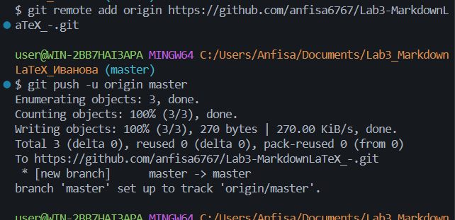

# Лабораторная работа №3. Markdown и LaTeX

Краткое описание: в ходе лабораторной работы были изучены возможности Markdown и базового LaTeX в документации проекта. Создана структура проекта, выполнены коммиты и push в GitHub. Оформлены примеры заголовков, списков, таблиц, ссылок, изображений, блоков кода, цитат, чекбоксов, сносок, alert-блоков и математических формул.

## Содержание

- [О проекте](#о-проекте)
- [Структура проекта](#структура-проекта)
- [Markdown-элементы](#markdown-элементы)
- [LaTeX](#latex)
- [Скриншоты](#скриншоты)

---

## О проекте

Проект создан для выполнения лабораторной работы №3.  
В нём показаны основные возможности Markdown и LaTeX.

---

## Структура проекта

- `docs/` - Markdown-файлы с примерами
- `img/` - скриншоты
- `latex/` - папка для примеров формул
- `README.md` - главный файл проекта
- `FormatDemo.cs` - пример программы на C#

### Вложенный список

- Документация
  - Заголовки
  - Списки
  - Таблицы
  - LaTeX

---

## Markdown-элементы

### Форматирование текста

**Полужирный**, *курсив*, ~~зачёркнутый~~, `моноширный`.

### Списки

1. Первый пункт
2. Второй пункт
   - Вложенный пункт
   - Ещё один вложенный пункт

### Цитата

> Это пример цитаты в Markdown.

### Блок кода

```bash
git status
git add .
git commit -m "Completed README.md"
```

### Таблица

| Элемент | Синтаксис | Назначение |
|:---|:---:|---:|
| Заголовок | `#` | Структура документа |
| Ссылка | `[текст](url)` | Переход |
| Код | `` `код` `` | Выделение команды |

### Изображение



### Ссылки

Внешняя ссылка: [GitHub](https://github.com)  
Внутренняя ссылка: [К структуре проекта](#структура-проекта)

### Чекбоксы

- [x] Создать структуру
- [x] Оформить README
- [ ] Проверить все пункты

### Сноска

Markdown удобен для документации[^1].

[^1]: Это примечание в стиле GitHub.

### Alert-блоки

> [!NOTE]
> Это простая заметка.

> [!TIP]
> Полезный совет.

> [!WARNING]
> Предупреждение.

### Inline LaTeX

Площадь круга: $S = \pi r^2$.

### Block LaTeX

$$
\sum_{i=1}^n i = \frac{n(n+1)}{2}
$$

---